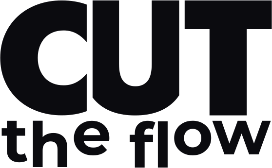
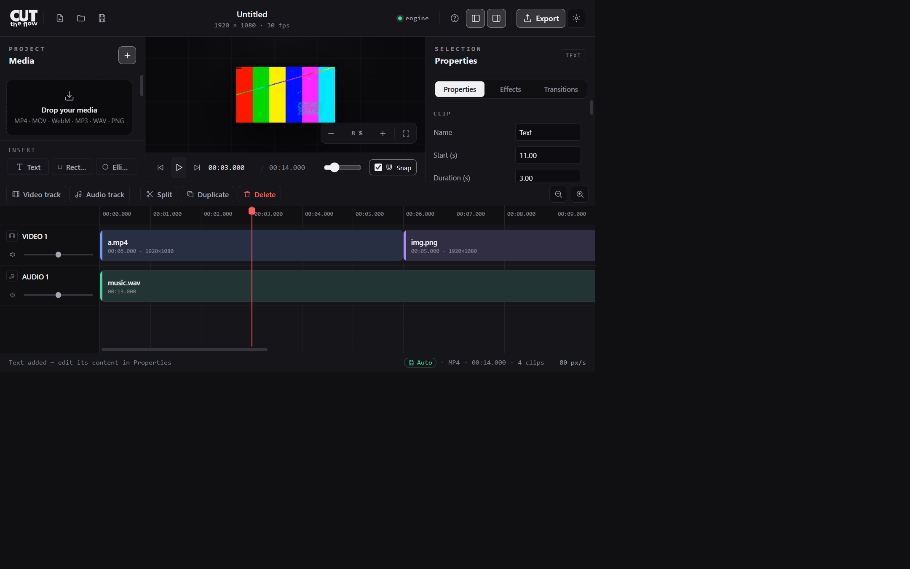

<p align="center">
  <picture>
    <source media="(prefers-color-scheme: dark)" srcset="docs/logo-on-dark.svg">
    <source media="(prefers-color-scheme: light)" srcset="docs/logo-on-light.svg">
    
  </picture>
</p>

<p align="center">
  <b>A multitrack video editor whose export is computed by ffmpeg, not by your GPU.</b><br>
  One Rust engine, one interface, the same frame-exact result on Windows, macOS and Linux.
</p>

<!-- Download links target the "latest" release, rebuilt on every push to main.
     They never change: asset names are stable across versions. -->
<p align="center">
  <a href="https://github.com/zigmoon/cuttheflow/releases/latest/download/CUTTHEFLOW-windows-x86_64-setup.exe"></a>
  <a href="https://github.com/zigmoon/cuttheflow/releases/latest/download/CUTTHEFLOW-macos-arm64.dmg"></a>
  <a href="https://github.com/zigmoon/cuttheflow/releases/latest/download/CUTTHEFLOW-linux-x86_64-desktop.zip"></a>
</p>

<p align="center">
  <sub>No install? The same studio runs online at
  <a href="https://app.zigmoon.com/CUTTHEFLOW/">app.zigmoon.com/CUTTHEFLOW</a> —
  export then runs on WebCodecs in the browser.</sub>
</p>

<p align="center">
  <a href="https://github.com/zigmoon/cuttheflow/actions/workflows/build.yml"></a>
  
  
  
  
</p>

<p align="center">
  
</p>

The executable ships the interface **and** the render engine, serves it from
`127.0.0.1` and shows it in its own window — WebView2 on Windows, WKWebView on
macOS, WebKitGTK on Linux. Nothing leaves your machine. `--web` opens the studio
in your browser instead, and a machine without a usable system WebView falls back
to it automatically.

---

## Download

Built by CI on every push. Windows ships an installer, macOS a disk image with a
real `.app`, the other targets archives.

| System | What you get | Bare binary |
|---|---|---|
| Windows 10/11 x64 | [`CUTTHEFLOW-windows-x86_64-setup.exe`](https://github.com/zigmoon/cuttheflow/releases/latest/download/CUTTHEFLOW-windows-x86_64-setup.exe) — installer, Start-menu shortcut, uninstaller | [`cuttheflow-windows-x86_64.exe`](https://github.com/zigmoon/cuttheflow/releases/latest/download/cuttheflow-windows-x86_64.exe) |
| Windows 10/11 x64 | [`CUTTHEFLOW-windows-x86_64.zip`](https://github.com/zigmoon/cuttheflow/releases/latest/download/CUTTHEFLOW-windows-x86_64.zip) — portable | |
| macOS Apple Silicon | [`CUTTHEFLOW-macos-arm64.dmg`](https://github.com/zigmoon/cuttheflow/releases/latest/download/CUTTHEFLOW-macos-arm64.dmg) — **CUT THE FLOW.app** | [`cuttheflow-macos-arm64`](https://github.com/zigmoon/cuttheflow/releases/latest/download/cuttheflow-macos-arm64) |
| macOS Intel | [`CUTTHEFLOW-macos-x86_64.dmg`](https://github.com/zigmoon/cuttheflow/releases/latest/download/CUTTHEFLOW-macos-x86_64.dmg) — **CUT THE FLOW.app** | [`cuttheflow-macos-x86_64`](https://github.com/zigmoon/cuttheflow/releases/latest/download/cuttheflow-macos-x86_64) |
| Linux x86-64 — native window | [`CUTTHEFLOW-linux-x86_64-desktop.zip`](https://github.com/zigmoon/cuttheflow/releases/latest/download/CUTTHEFLOW-linux-x86_64-desktop.zip) — needs WebKitGTK 4.1 | [`cuttheflow-linux-x86_64-desktop`](https://github.com/zigmoon/cuttheflow/releases/latest/download/cuttheflow-linux-x86_64-desktop) |
| Linux x86-64 — self-contained | [`CUTTHEFLOW-linux-x86_64.zip`](https://github.com/zigmoon/cuttheflow/releases/latest/download/CUTTHEFLOW-linux-x86_64.zip) — no dependency at all | [`cuttheflow-linux-x86_64`](https://github.com/zigmoon/cuttheflow/releases/latest/download/cuttheflow-linux-x86_64) |
| Linux ARM64 — self-contained | [`CUTTHEFLOW-linux-aarch64.zip`](https://github.com/zigmoon/cuttheflow/releases/latest/download/CUTTHEFLOW-linux-aarch64.zip) | [`cuttheflow-linux-aarch64`](https://github.com/zigmoon/cuttheflow/releases/latest/download/cuttheflow-linux-aarch64) |

Integrity: [`SHA256SUMS.txt`](https://github.com/zigmoon/cuttheflow/releases/latest/download/SHA256SUMS.txt).
All releases: [releases](https://github.com/zigmoon/cuttheflow/releases).

**Start it.** Windows: run the installer, then launch **CUT THE FLOW** from the
Start menu. macOS: open the `.dmg`, drag **CUT THE FLOW** into *Applications*.
Linux: extract the archive, then `bash demarrer.sh` (`bash installer.sh` adds the
menu entry and icon). The studio listens on <http://127.0.0.1:7317/> only.

> **macOS first launch.** Builds are ad-hoc signed (mandatory on Apple Silicon)
> but not notarised, so Gatekeeper asks once: right-click the app → **Open**, or
> *Privacy & Security → Open Anyway*. For the bare binary:
> `xattr -d com.apple.quarantine cuttheflow-macos-arm64`. Windows builds are
> unsigned too — SmartScreen may ask for confirmation.

### ffmpeg is optional

The studio picks the right path by itself.

| | Without ffmpeg | With ffmpeg |
|---|---|---|
| Import, edit, preview | embedded view (IndexedDB) | engine |
| Export MP4 / WebM / MP3 | WebCodecs (LAME for MP3) | ffmpeg |
| Keyframes, masks, speed | yes | yes |
| Quality control | bitrate only | CRF + preset |
| Long edits, background tab | bounded by the tab | unaffected |
| Reproducible output | no (hardware encoder) | **yes** — same ffmpeg build, byte-identical |

`winget install Gyan.FFmpeg` (Windows), `brew install ffmpeg` (macOS),
`apt install ffmpeg` (Linux), or drop `ffmpeg` and `ffprobe` next to the
executable. `cuttheflow doctor` reports what was found.

---

## What it does

**Timeline**
- as many video and audio tracks as you need
- drag a clip **up or down to change track** — the target row highlights, and a
  track that cannot hold that clip is outlined instead of quietly losing it;
  `Alt + ↑/↓` does the same from the keyboard
- dropping a media places it **where you release it**: on the hovered track when
  it is free at that instant, otherwise on a new track at that row. A clip is
  never pushed after the last shot
- trim either edge, snap to clips / playhead / zero
- split, duplicate, delete; undo / redo across every edit
- zoom 0.25 → 1024 px/s with `Ctrl` + wheel, centred on the cursor; `Ctrl+Shift+0`
  frames the whole edit
- audio waveforms drawn on the clips

**Composition**
- scale, position, rotation, opacity, with **keyframes** (linear, ease-in,
  ease-out, ease-in-out). Keyframe times are clip-local, so moving a clip never
  shifts its animation
- **speed** 0.25× → 4×: 2× halves the clip on the timeline instead of trimming
  it, audio included
- **masks** — rectangle or ellipse, feathered, invertible; the mask cuts the clip,
  not the layers underneath
- fades, 13 effects, fade and dissolve transitions, text and shape clips

**Studio**
- French and English, dark and light themes
- projects are JSON, media stays local
- installable PWA that works offline and says when a new version is ready
- encoder pre-flight: unsupported combinations are greyed out before you wait
  for an export that would fail

---

## Command line

```bash
cuttheflow                       # native window (browser if the build has none)
cuttheflow --web                 # force the default browser
cuttheflow serve --port 7317 --no-open
cuttheflow doctor                # ffmpeg, encoders, font
cuttheflow probe film.mp4        # metadata as JSON
cuttheflow export project.json --out film.mp4 --format mp4 --crf 18
```

`serve` starts even without ffmpeg: it announces browser mode instead of refusing
to launch. Same for the window — no WebKitGTK, no graphical session, and the
studio says so and opens in the browser rather than exiting.

---

## Build from source

Rust 1.80+, Node 20.3+.

```bash
npm ci --prefix astro && npm run build --prefix astro
cargo build --release --manifest-path rust/Cargo.toml -p ctf-app                     # server only
cargo build --release --manifest-path rust/Cargo.toml -p ctf-app --features desktop  # native window
./rust/target/release/cuttheflow
```

`--features desktop` pulls in `wry` + `tao`; it needs WebKitGTK 4.1 and GTK 3
headers on Linux, nothing extra on Windows or macOS. `.github/workflows/build.yml`
is the reference: six targets built natively on their own OS, then published.

---

## Architecture

```
astro/              interface: TypeScript + Astro, compiled to static files
  src/scripts/      state, renderer, preview, timeline, editor, export
  public/           service worker, manifest, icons
rust/
  crates/ctf-core    model, timeline resolver, ffprobe parsing, filter graph
  crates/ctf-engine  ffmpeg execution: audio mix, composition, export
  crates/ctf-app     CLI + local HTTP server, embeds astro/dist, native window
v1/                 the previous browser-only editor, kept for reference
```

`state.ts` and `model.rs` describe the same project, and the preview composites
with the same placement rules the export uses. `astro/dist` is embedded at
compile time, so one file carries the whole studio. The window does not replace
the server: `server.rs` binds `127.0.0.1` and a WebView points at it — which is
why `--web` is a one-line switch.

---

## Verification

The bench replays a reference edit (13 s: video, image, video, text, two audio
tracks with 880/1500/1200 Hz beacons) and inspects the files with ffmpeg.

| Check | Result |
|---|---|
| Frames | **390 / 390** |
| Video / audio duration | **13.000 s / 13.000 s** |
| Audio sync in MP4 (start and end of each beacon) | **0 ms** |
| Sync WebM − MP4, MP3 − MP4 | **0 ms** |
| Black frames at cuts | none (min luminance 67/255) |
| Frame fidelity vs source | 0 differing frames out of 177 |
| Total | **45 / 45** |

```bash
cargo test --workspace --manifest-path rust/Cargo.toml    # 49 unit tests
cd rust && node scripts/verify-export.mjs                 # 45 ffmpeg checks
npm run check --prefix astro                              # 0 error, 0 warning
node tools/v3-test.cjs                                    # 35/35 in a real Chrome
```

The export bench finds its own defaults (`rust/target/release/cuttheflow` and
`v1/tools/regression/media`); `--bin` and `--media` override them.

The interface bench covers import, drop on a row, vertical drag between tracks
and its refusal on an incompatible track, zoom, scrub-while-playing, undo,
keyframes, masks, absence of untranslated labels in both languages, service-worker
update and engine badge states. Effects and transitions are checked on real
pixels (a 0.5 s dissolve reads `29,29,29` → `121,13,68` → `201,0,102`, i.e. both
sources really mixed); browser export fidelity is PSNR **43.6 dB**, SSIM
**0.996**. Each release binary is then checked on its own: `--version`,
`--help`, `/api/health`, and the studio actually served.

**Local only.** The engine binds `127.0.0.1`, refuses any request whose `Host`
is not `127.0.0.1` / `localhost` / `[::1]`, and rejects cross-origin writes. That
combination keeps a web page from reaching your media through DNS rebinding.
Binding to another interface with `--host` is an explicit opt-out; put an
authenticating proxy in front of it.

---

## Project format

One JSON file: timeline in microseconds, media referenced by id, export settings.
The Rust engine reads the same structure, so a project saved in the browser can be
exported by the CLI and vice versa.

```jsonc
{
  "version": 1,
  "width": 1920, "height": 1080,
  "fps": { "num": 30, "den": 1 },
  "tracks": [{
    "kind": "video",
    "clips": [{
      "type": "video", "start_us": 0, "duration_us": 3000000,
      "source_start_us": 0, "speed": 1.0,
      "keyframes": [{ "prop": "opacity", "time_us": 0, "value": 1, "easing": "linear" }],
      "mask": { "kind": "ellipse", "x": 0.5, "y": 0.5, "width": 0.8, "height": 0.8 }
    }]
  }],
  "export": { "format": "mp4", "crf": 18, "preset": "medium" }
}
```

---

## Limits

- the Linux native-window build needs WebKitGTK 4.1 and GTK 3 at run time; the
  self-contained build exists for machines that have neither
- macOS builds are signed ad-hoc; Developer ID signing and notarisation run in CI
  only when the Apple secrets are configured
- 4K H.264 encoding depends on the machine's encoder; VP9 handles it more often
- there is no auto-updater: the studio tells you a newer release exists, you
  download it from the releases page
- subtitles and 4K proxies, from the v1 editor, are not implemented yet

---

## License

Proprietary — see [LICENSE](LICENSE). The studio is free to use; the source is
published for transparency.
