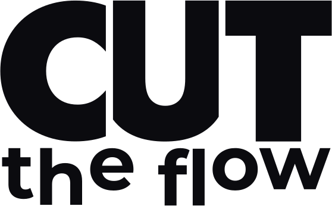
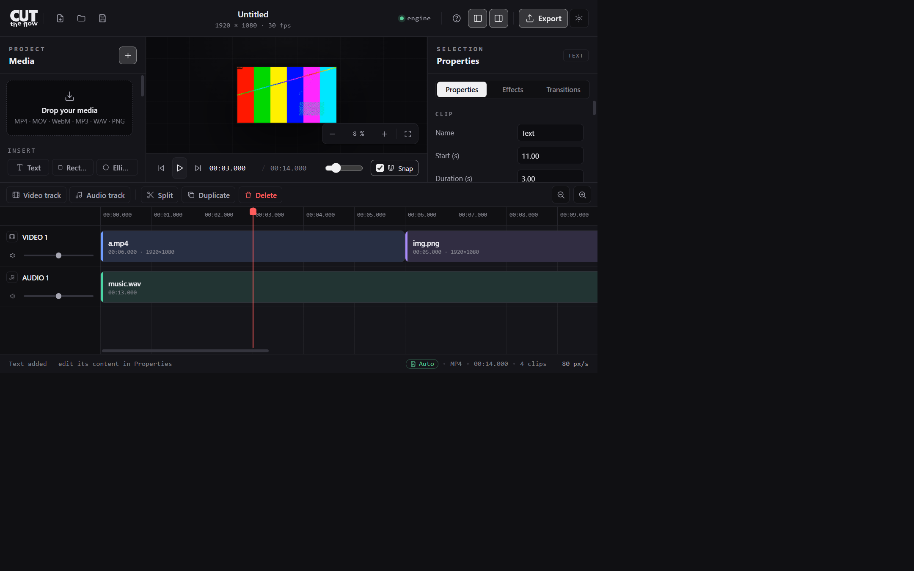

<p align="center">
  <picture>
    <source media="(prefers-color-scheme: dark)" srcset="docs/logo-on-dark.svg">
    <source media="(prefers-color-scheme: light)" srcset="docs/logo-on-light.svg">
    
  </picture>
</p>

<p align="center">
  <b>A desktop video editor whose export is computed by ffmpeg, not by your GPU.</b><br>
  Multitrack editing in its own window, one deterministic render engine for<br>
  Windows, macOS and Linux — the same project produces the same file everywhere.
</p>

<!-- Les liens de téléchargement pointent sur la release « latest », reconstruite
     à chaque poussée sur main. Ils ne changent jamais : les fichiers gardent le
     même nom d'une version à l'autre. -->
<p align="center">
  <a href="https://github.com/zigmoon/cuttheflow/releases/latest/download/CUTTHEFLOW-windows-x86_64-setup.exe"></a>
  <a href="https://github.com/zigmoon/cuttheflow/releases/latest/download/CUTTHEFLOW-macos-arm64.dmg"></a>
  <a href="https://github.com/zigmoon/cuttheflow/releases/latest/download/CUTTHEFLOW-linux-x86_64-desktop.zip"></a>
</p>

<p align="center">
  <sub>Windows : installateur, raccourci dans le menu Démarrer, désinstallation propre.<br>
  macOS : image disque contenant <b>CUT THE FLOW.app</b> — glissez-la dans Applications.<br>
  macOS Intel, Linux ARM64 et les archives portables : tableau ci-dessous.</sub>
</p>

<p align="center">
  <a href="https://github.com/zigmoon/cuttheflow/actions/workflows/build.yml"></a>
  
  
  <a href="https://github.com/zigmoon/cuttheflow/releases/latest"></a>
  
</p>

<p align="center">
  
  
  
  
  
</p>

<p align="center">
  
</p>

> **How it runs.** CUT THE FLOW is a local studio: the executable ships the
> render engine *and* serves the interface from `127.0.0.1`, then shows it in
> **its own application window** — WebView2 on Windows 10/11, WKWebView on
> macOS, WebKitGTK on Linux. No tabs, no address bar, no browser to install.
> Nothing leaves your machine. There is no Electron or Qt shell: the UI is web,
> which is what makes one binary enough for three systems. `--web` opens the
> studio in your default browser instead, and a machine without a usable system
> WebView falls back to it automatically — announced, never silent.

---

## Download

Six native builds, published by CI on every commit: no build tools needed on
your side. Windows ships an installer, macOS ships a disk image with a real
`.app`; the other targets ship archives.

| System | What you get | Bare binary |
|---|---|---|
| Windows 10/11 x64 | [`CUTTHEFLOW-windows-x86_64-setup.exe`](https://github.com/zigmoon/cuttheflow/releases/latest/download/CUTTHEFLOW-windows-x86_64-setup.exe) — installer, Start-menu shortcut, uninstaller | [`cuttheflow-windows-x86_64.exe`](https://github.com/zigmoon/cuttheflow/releases/latest/download/cuttheflow-windows-x86_64.exe) |
| Windows 10/11 x64 | [`CUTTHEFLOW-windows-x86_64.zip`](https://github.com/zigmoon/cuttheflow/releases/latest/download/CUTTHEFLOW-windows-x86_64.zip) — portable, nothing installed | |
| macOS Apple Silicon | [`CUTTHEFLOW-macos-arm64.dmg`](https://github.com/zigmoon/cuttheflow/releases/latest/download/CUTTHEFLOW-macos-arm64.dmg) — **CUT THE FLOW.app**, drag to Applications | [`cuttheflow-macos-arm64`](https://github.com/zigmoon/cuttheflow/releases/latest/download/cuttheflow-macos-arm64) |
| macOS Intel | [`CUTTHEFLOW-macos-x86_64.dmg`](https://github.com/zigmoon/cuttheflow/releases/latest/download/CUTTHEFLOW-macos-x86_64.dmg) — **CUT THE FLOW.app** | [`cuttheflow-macos-x86_64`](https://github.com/zigmoon/cuttheflow/releases/latest/download/cuttheflow-macos-x86_64) |
| Linux x86-64 — **native window** | [`CUTTHEFLOW-linux-x86_64-desktop.zip`](https://github.com/zigmoon/cuttheflow/releases/latest/download/CUTTHEFLOW-linux-x86_64-desktop.zip) — needs WebKitGTK 4.1 | [`cuttheflow-linux-x86_64-desktop`](https://github.com/zigmoon/cuttheflow/releases/latest/download/cuttheflow-linux-x86_64-desktop) |
| Linux x86-64 — self-contained | [`CUTTHEFLOW-linux-x86_64.zip`](https://github.com/zigmoon/cuttheflow/releases/latest/download/CUTTHEFLOW-linux-x86_64.zip) — no dependency at all | [`cuttheflow-linux-x86_64`](https://github.com/zigmoon/cuttheflow/releases/latest/download/cuttheflow-linux-x86_64) |
| Linux ARM64 — self-contained | [`CUTTHEFLOW-linux-aarch64.zip`](https://github.com/zigmoon/cuttheflow/releases/latest/download/CUTTHEFLOW-linux-aarch64.zip) | [`cuttheflow-linux-aarch64`](https://github.com/zigmoon/cuttheflow/releases/latest/download/cuttheflow-linux-aarch64) |

Integrity: [`SHA256SUMS.txt`](https://github.com/zigmoon/cuttheflow/releases/latest/download/SHA256SUMS.txt).
All releases: [releases](https://github.com/zigmoon/cuttheflow/releases).

### Start it

| System | How |
|---|---|
| Windows | double-click `CUTTHEFLOW-windows-x86_64-setup.exe`, then launch **CUT THE FLOW** from the Start menu |
| macOS | open the `.dmg`, drag **CUT THE FLOW** into *Applications*, then launch it from Launchpad |
| Linux | extract the archive, then `bash demarrer.sh` (or run `./cuttheflow`) |

The studio opens **in its own application window** — Windows uses the WebView2
engine already present on Windows 10/11, macOS uses WKWebView, Linux uses
WebKitGTK. There is no address bar, no tab strip, and no browser to install.

Either way it is served from <http://127.0.0.1:7317/>: the server listens on
`127.0.0.1` only, refuses other origins, and nothing leaves your machine.

> **macOS first launch.** Builds are ad-hoc signed (mandatory on Apple Silicon),
> but not notarised by Apple, so Gatekeeper asks once. Right-click the app →
> **Open**, or *System Settings → Privacy & Security → Open Anyway*. The same
> applies to the bare binary: `xattr -d com.apple.quarantine cuttheflow-macos-arm64`.
> Only an Apple Developer ID + notarisation would remove that step; it runs
> automatically when the Apple secrets are configured in the repository.

### ffmpeg is optional

The studio runs two ways, and picks the right one by itself:

| | Without ffmpeg | With ffmpeg |
|---|---|---|
| Import, edit, preview | browser (IndexedDB) | engine |
| Export MP4 / WebM / MP3 | browser (WebCodecs, LAME) | ffmpeg |
| Identical file on every OS | depends on the browser | **yes** |
| Long edits | bounded by the tab | frame-exact |

Install it once to get the deterministic engine — `winget install Gyan.FFmpeg`
(Windows), `brew install ffmpeg` (macOS), `apt install ffmpeg` (Linux) — or drop
`ffmpeg` and `ffprobe` next to the executable. `cuttheflow doctor` reports what
was found.

---

## Why another editor

Browser editors encode with WebCodecs. That works, until it doesn't: Safari and
Firefox have no H.264 encoder, the realtime fallback drifts on long edits, a
background tab freezes the export, and the output depends on the machine's GPU.

CUT THE FLOW keeps the pleasant part — timeline, trim, snap, effects,
transitions, shapes, keyframes, live preview — and hands the rendering to
**ffmpeg**, driven by a Rust engine with a single, testable synchronisation
model.

| | Browser engine | This engine |
|---|---|---|
| Encoder | WebCodecs / GPU | ffmpeg, fixed settings |
| Long edits | realtime fallback, drifts | frame-exact |
| Background tab | export stalls | unaffected |
| Same file on every OS | no | **yes** |
| Verifiable output | hard | measured on every build |

---

## What it does

**Timeline**
- video and audio tracks, as many as you need
- dragging from the media panel **creates a track at the drop point** and places
  the clip exactly where you released it
- trim either edge, snap to clips / playhead / zero
- split, duplicate, delete; undo / redo across every edit
- zoom 0.25 → 1024 px/s with Ctrl + wheel, centred on the cursor; `Ctrl+Shift+0`
  frames the whole edit
- a thin scrub rail keeps the timeline usable when the panel is collapsed
- audio waveforms drawn on the clips

**Composition**
- scale, position, rotation, opacity — with **keyframes** (linear, ease-in,
  ease-out, ease-in-out, per key). Keyframe times are clip-local, so moving a
  clip never shifts its animation
- **speed** 0.25× → 4×, keeping the same portion of the source: 2× halves the
  clip on the timeline instead of trimming it, audio included
- **masks**: rectangle or ellipse, feathered, invertible; the mask cuts the clip
  itself, not the layers underneath
- fades, 13 effects (blur, shine, pixelate, mirror, glitch, VHS, duotone…),
  fade and dissolve transitions, text and shape clips

**Studio**
- French and English UI, dark and light themes
- projects are JSON; media stays local (IndexedDB in browser mode)
- installable PWA, works offline, and tells you when a new version is ready
- encoder pre-flight: unsupported combinations are greyed out before you wait
  for an export that would fail

---

## Command line

```bash
cuttheflow                       # native window (browser if the build has none)
cuttheflow --web                  # force the default browser instead
cuttheflow serve --port 7317 --no-open
cuttheflow doctor                # ffmpeg, encoders, font
cuttheflow probe film.mp4        # metadata as JSON
cuttheflow export projet.json --out montage.mp4 --format mp4 --crf 18
```

`serve` starts even when ffmpeg is missing: it announces browser mode instead of
refusing to launch. The same is true of the native window — if WebKitGTK is
absent on Linux, or there is no graphical session, the studio says so and opens
in the browser rather than exiting.

---

## Build from source

Prerequisites: Rust 1.80+, Node 20.3+.

```bash
npm ci --prefix astro && npm run build --prefix astro
cargo build --release --manifest-path rust/Cargo.toml -p ctf-app                    # server only
cargo build --release --manifest-path rust/Cargo.toml -p ctf-app --features desktop # native window
./rust/target/release/cuttheflow
```

`--features desktop` pulls in `wry` + `tao`. It needs WebKitGTK 4.1 and GTK 3
development headers on Linux (`libwebkit2gtk-4.1-dev libgtk-3-dev`); Windows and
macOS need nothing extra, the system WebView is part of the OS.

`rust/scripts/build.ps1` is the local shortcut: it builds the Windows binary
*native* plus cross-compiled Linux and macOS binaries (without the native
window — that one needs the host toolchain). `.github/workflows/build.yml` is
the reference: it builds all **six** targets natively on their own OS, including
the Linux native-window build, then publishes the release.

---

## Architecture

```
astro/            interface: TypeScript + Astro, compiled to static files
  src/scripts/    state, renderer, preview, timeline, editor, export
  public/         service worker, manifest, icons
rust/
  crates/ctf-core     model, timeline resolver, ffprobe parsing, filter graph
  crates/ctf-engine   ffmpeg execution: audio mix, composition, export
  crates/ctf-app      binary: CLI + local HTTP server, embeds astro/dist
    desktop.rs        native window: WebView2 / WKWebView / WebKitGTK
  scripts/            build.ps1, launchers, distribution notes
```

The interface and the engine share one model: `state.ts` and `model.rs` describe
the same project, and the preview composites with the same placement rules the
export uses. `astro/dist` is embedded in the binary at compile time, so a single
file carries the whole studio.

The native window does not replace the server: `server.rs` binds `127.0.0.1`,
then `desktop.rs` points a WebView at it. That is why the same interface works in
all three shells, and why `--web` is a one-line switch.

---

## Verification

The bench replays a reference edit (13 s, five clips: video, image, text, two
audio tracks with 880/1500/1200 Hz beacons) and inspects the files with ffmpeg.

| Check | Result |
|---|---|
| Frames | **390 / 390** |
| Video / audio duration | **13.000 s / 13.000 s** |
| Audio sync, MP4 (start and end of each beacon) | **0 ms** |
| Sync WebM − MP4, MP3 − MP4 | **0 ms** |
| Black frames at cuts | none (min luminance 67/255) |
| Frame fidelity vs source | 0 differing frames out of 177 |
| Total | **45 / 45** |

```bash
cd rust
cargo test --workspace                # 32 unit tests
node scripts/verify-export.mjs        # 45 ffmpeg checks
```

Interface: `npm run check` → 0 error, 0 warning; `node tools/v3-test.cjs` →
**32/32** in a real Chrome (drag-and-drop, zoom, scrub-while-playing, undo,
keyframes, masks, service-worker update, engine badge states). Effects and
transitions were verified on real pixels (sepia `44,39,30`; ellipse `#F0F0F2`; a
0.5 s dissolve reading `29,29,29` → `121,13,68` → `201,0,102`, i.e. the two
sources really mixed). Static fidelity in browser export: PSNR **43.6 dB**,
SSIM **0.996**. Each release binary is then checked on its own: `--version`,
forbidden imports, and the studio actually booting in the window.

---

## Project format

A project is a single JSON file: timeline in microseconds, media referenced by
id, export settings. It is the same structure the Rust engine reads, so a project
written by the browser can be exported by the CLI and vice versa.

```jsonc
{
  "version": 1,
  "width": 1920, "height": 1080,
  "fps": { "num": 30, "den": 1 },
  "tracks": [{
    "kind": "video",
    "clips": [{
      "type": "video", "start_us": 0, "duration_us": 3000000,
      "source_start_us": 0, "speed": 1.0,
      "keyframes": [{ "prop": "opacity", "time_us": 0, "value": 1, "easing": "linear" }],
      "mask": { "kind": "ellipse", "x": 0.5, "y": 0.5, "width": 0.8, "height": 0.8 }
    }]
  }],
  "export": { "format": "mp4", "crf": 18, "preset": "medium" }
}
```

---

## Limits

- keyframes, masks and speed are rendered by the **browser inside the window**
  (WebCodecs) even when the engine is available: ffmpeg support for them is not
  there yet, and the export dialog says so instead of silently producing a wrong
  file
- the Linux *native window* build needs WebKitGTK 4.1 and GTK 3 at run time. The
  *self-contained* build exists exactly for machines that have neither — it
  depends on nothing and opens the studio in the browser
- macOS builds are signed ad-hoc; Developer ID signing and notarisation happen
  in CI only when the Apple secrets are configured
- Windows builds are unsigned: SmartScreen may ask for confirmation
- 4K H.264 encoding depends on the browser; VP9 handles it more often
- there is no auto-updater: the studio tells you when a newer release exists, you
  download it from the releases page

---

## The previous generation: `v1/`

`v1/` is the earlier browser-only editor (single HTML page, WebCodecs and
MediaRecorder). It is kept for reference and regression tests; it is not the
shipped product.

---

## License

Proprietary — see [LICENSE](LICENSE). The studio is free to use; the source is
published for transparency.
